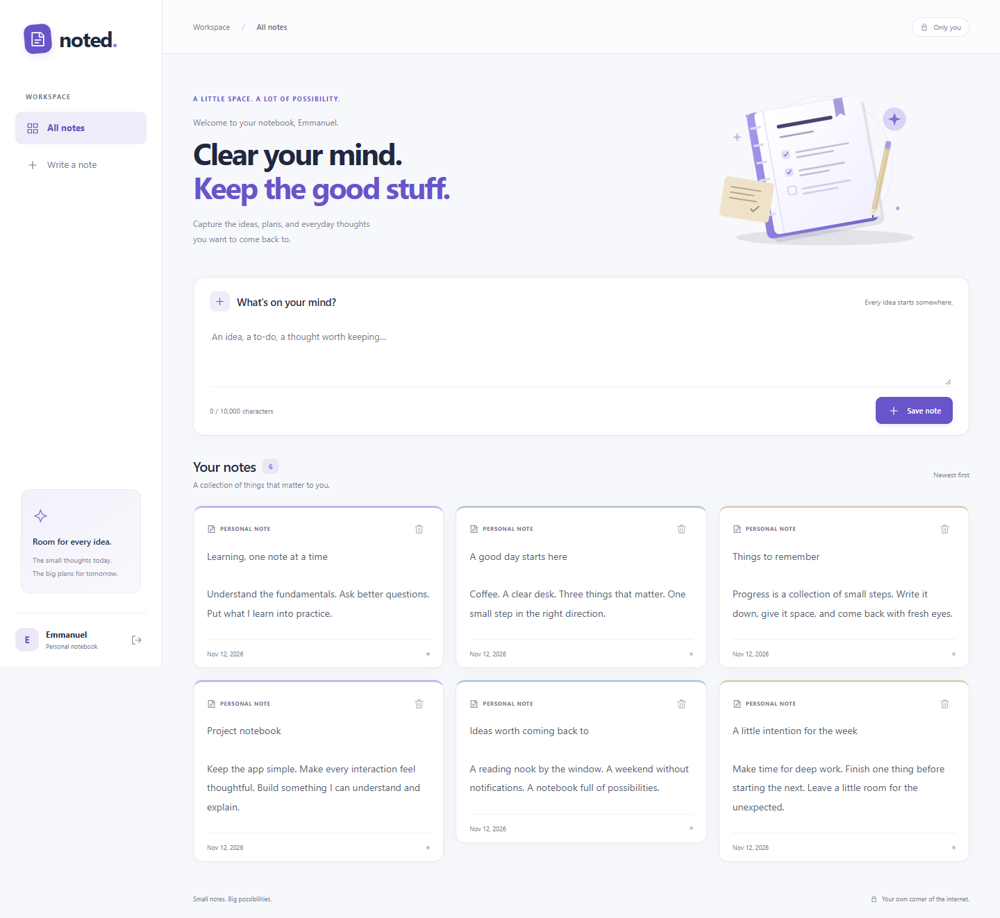
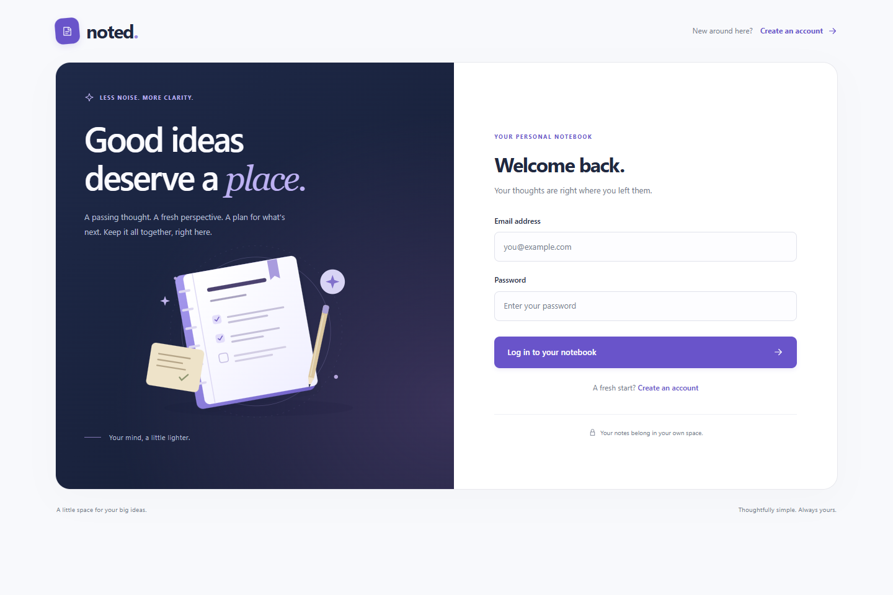
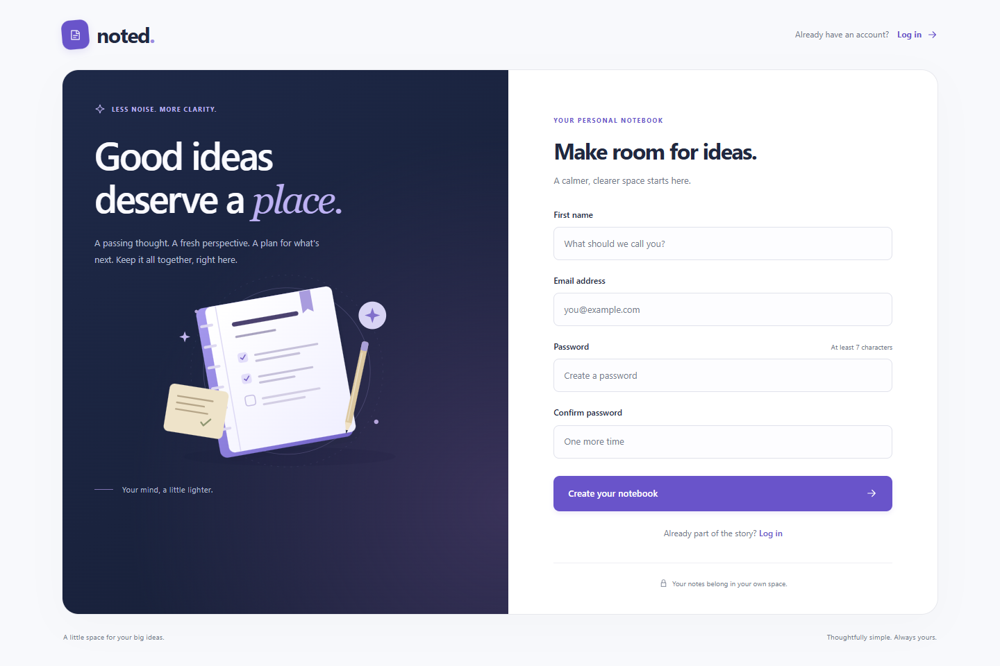

# Noted · Flask Note-Taking App

A quiet place for everyday thoughts. Noted is the existing Flask note-taking app, refreshed with a navy and violet interface while keeping its simple routes, SQLite storage, and personal notes.

Originally adapted by Emmanuel Akinlusi from [Tech With Tim's Flask Web App Tutorial](https://github.com/techwithtim/Flask-Web-App-Tutorial). That foundation and attribution are preserved.

## Features

- Register, log in, and log out.
- Create, read, and delete your own notes.
- Responsive note cards, clear empty states, character counts, and deletion confirmation.
- Login and registration screens with an original, lightweight SVG notebook illustration.
- CSRF protection, owner-scoped note access, escaped plain-text notes, and environment-based secrets.
- SQLite persistence using the original User and Note tables.
- A public JSON liveness endpoint at `/health`.

The original app has no note-editing route. Editing, collaboration, AI, and other new product features are outside this update.

## Screenshots

Screenshots use a temporary account and sample notes, never the application's database.



| Login | Registration |
| --- | --- |
|  |  |

[Mobile dashboard](docs/screenshots/dashboard-mobile.png) · [Mobile login](docs/screenshots/login-mobile.png) · [Empty notebook](docs/screenshots/dashboard-empty.png)

## Technologies and structure

Python 3.10+; verified on Python 3.13. Flask, Flask-Login, Flask-SQLAlchemy, Flask-WTF, Werkzeug, and SQLite. The frontend uses Jinja templates, ordinary CSS, and a small JavaScript file. No frontend build step, CDN, external fonts, or remote images are needed.

```text
main.py                    # Local startup; also exposes main:app for a future WSGI server
requirements.txt           # Tested runtime dependency versions
requirements-dev.txt       # Pytest and Playwright, for development only
website/
  __init__.py              # App factory, configuration, CSRF, and errors
  auth.py                  # Existing authentication routes
  security.py              # Legacy password verification
  views.py                 # Notes and health routes
  models.py                # Original unchanged database schema
  templates/               # Shared layout, authentication, notes, and errors
  static/                  # Local CSS, JavaScript, original SVG assets
instance/database.db       # Local SQLite data; ignored by Git
tests/                     # Isolated backend tests and browser checks
docs/                      # Verification notes and screenshots
```

## Install and run

Clone this repository and create an isolated environment:

```bash
git clone https://github.com/Emmanuel2005-creator/Website.git
cd Website
python -m venv .venv
```

On Windows PowerShell:

```powershell
.\.venv\Scripts\Activate.ps1
python -m pip install -r requirements.txt
$env:SECRET_KEY = python -c "import secrets; print(secrets.token_hex(32))"
python main.py
```

On macOS/Linux:

```bash
source .venv/bin/activate
python -m pip install -r requirements.txt
export SECRET_KEY="$(python -c 'import secrets; print(secrets.token_hex(32))')"
python main.py
```

Open [http://127.0.0.1:5000](http://127.0.0.1:5000). Debug mode is off by default. For explicit local debugging only, use `flask --app main run --debug`.

The example commands generate a new key for that shell session. For regular use, set a long, randomly generated key once in your environment or secret manager and retain it across restarts. Never commit it.

## Configuration

| Environment variable | Default | Purpose |
| --- | --- | --- |
| `SECRET_KEY` | Required | Signs sessions and CSRF tokens. Startup fails clearly if absent. |
| `DATABASE_URL` | `sqlite:///database.db` | Relative SQLite paths resolve inside Flask's `instance/` directory. |
| `COOKIE_SECURE` | `false` | Set `true` when serving over HTTPS to secure session and remember cookies. |

`.env.example` documents these values. The app reads process environment variables; it does **not** automatically load a `.env` file.

To select a different local SQLite file in PowerShell:

```powershell
$env:DATABASE_URL = 'sqlite:///notes-local.db'
```

For an absolute Windows path, use forward slashes: `sqlite:///C:/data/noted/database.db`. Create that parent directory first. Keep SQLite on a persistent writable volume when containerization is introduced.

## Existing data and account compatibility

- Back up your existing SQLite file outside the checkout **before** switching to or pulling this branch. Git can remove a previously tracked file during a branch change. This update stops tracking the old database, while the working copy used for development is preserved byte for byte.
- The default location remains `instance/database.db`. Point `DATABASE_URL` at your actual existing database if it lives elsewhere; selecting an empty path creates a separate database.
- The schema and existing note contents are unchanged. Startup creates missing tables; it never drops tables, resets data, or performs migrations.
- Existing salted `sha256$salt$digest` passwords are verified using the original Werkzeug HMAC-SHA256 format. Existing PBKDF2 and scrypt hashes also remain supported. Login leaves stored password hashes unchanged.
- New accounts use Werkzeug's scrypt default. Registration validates email, name, and password length. Login also accepts unusual credentials allowed by the original app.
- Replacing the published secret key invalidates old sessions. Users must log in again; account passwords and notes remain intact.
- Notes remain escaped plain text, preserving whitespace. New notes must contain non-whitespace text and be at most 10,000 characters; older larger notes remain readable.

The [legacy Werkzeug implementation](https://github.com/pallets/werkzeug/blob/2.2.3/src/werkzeug/security.py) documents the old hashing format. CSRF follows [Flask-WTF's form and JavaScript guidance](https://flask-wtf.readthedocs.io/en/latest/csrf/).

## Routes

| Route | Methods | Behavior |
| --- | --- | --- |
| `/` | GET, POST | Authenticated personal dashboard; POST creates a note. |
| `/login` | GET, POST | Existing login route. |
| `/sign-up` | GET, POST | Existing registration route. |
| `/logout` | GET, POST | GET confirms logout; CSRF-protected POST ends the session. |
| `/delete-note` | POST | Authenticated JSON `{"noteId": 123}`; owner-scoped deletion. |
| `/health` | GET | Public `{"status":"ok"}`, HTTP 200. |

All state-changing requests require a valid CSRF token. Forms include a hidden `csrf_token`; deletion sends `X-CSRFToken`. Missing/invalid CSRF returns 400. Authenticated deletion returns 400 for malformed input, 404 for a missing or other user's note, and 200 with `{}` on success. Anonymous deletion with a valid CSRF token returns 401; CSRF is checked first.

## Tests

Install development dependencies, then run the backend tests:

```bash
python -m pip install -r requirements-dev.txt
python -m pytest -q
python -m pip check
```

Tests create temporary SQLite databases and synthetic accounts. They do not read or write your application database.

For real browser checks and screenshots:

```bash
python -m playwright install chromium
python tests/browser_check.py
```

Alternatively, use an existing Edge installation in PowerShell:

```powershell
$env:BROWSER_CHANNEL = 'msedge'
python tests/browser_check.py
```

The browser script starts a temporary local server, exercises account and note flows, checks narrow/desktop layouts and keyboard focus, simulates a failed delete, and writes screenshots to `docs/screenshots/`. Close the server automatically when finished. See [verification results and complete changed-file list](docs/verification.md).

## CloudOps handoff and limits

This is the application-improvement phase only. Docker, Terraform, AWS, GitHub Actions, and CloudWatch configuration are intentionally left for future learning phases.

- `main:app` and `website:create_app()` provide straightforward entry points for a future production WSGI server. `python main.py` uses Flask's local development server.
- `/health` is a liveness check; it does not query the database or report readiness.
- A future hosting phase must add HTTPS, production serving, backups, persistent storage, and suitable monitoring. SQLite is retained; multi-instance storage planning is deferred.
- No account recovery or authentication rate limiting is added in this phase.
- The browser suite is verified in Chromium-based Edge. Safari and Firefox were not tested.
- Flask-Login 0.6.3 emits Python 3.13 `datetime.utcnow()` deprecation warnings for remember-cookie creation. They are upstream warnings; the tests pass, and warnings remain visible.
- Existing database and secret-key history is preserved. Stopping tracking prevents future data commits; it does not remove historical Git objects.

All illustrations and icons added here are original inline/local SVGs. No third-party imagery is bundled. The repository's tutorial attribution remains above; this update does not declare a new project license.
